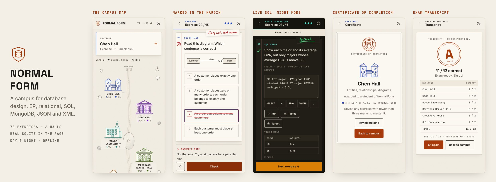

# 🗄️ Data Yard: Database Design Quest

Learn database design by playing. Data Yard is a single-page browser game that covers a second-year
Database Design course: ER modelling, relational notation, normalization, relational algebra, SQL,
MongoDB, JSON and XML. There is **nothing to install and no database to set up**. Open `index.html` and play.

### ▶ [Play now: wrightjayn.github.io/data-yard](https://wrightjayn.github.io/data-yard/)



🎬 **Demo video (30s, with music):** [docs/demo.mp4](docs/demo.mp4)

## What's inside

| World | Topics |
|---|---|
| 🏝️ **ER Bay** | Entities, attributes, relationships, cardinality, crow's foot notation, weak entities, generalization, ANSI/SPARC |
| 📐 **Relation Ridge** | Relational notation (PK/FK), entity & referential integrity, functional dependency, 1NF → 4NF, relational algebra & calculus |
| 🧪 **SQL Lab** | Real SQLite in the browser: SELECT, WHERE, LIKE, GROUP BY/HAVING, JOINs, sub-queries, INSERT/UPDATE/DELETE, CREATE/ALTER |
| 🍃 **Mongo Market** | `find()` filters, `$gt` `$in` `$or` `$elemMatch`, dot notation, projection, sort/limit, insertOne/updateOne, embed vs reference |
| 🧾 **JSON Junction** | Syntax rules, data types, fixing broken JSON, writing JSON, table → JSON |
| 🏷️ **XML Cove** | Well-formed rules, elements vs attributes, JSON → XML, XPath, valid vs well-formed, hierarchical & network models |

Plus:
- **👑 Exam Boss:** 12 random questions from every world, one try each, graded A–F.
- **🛠️ Sandbox:** free play with SQL, Mongo, JSON and XML, plus JSON ↔ XML conversion.

Each world opens with short lesson cards. You earn 1–3 stars per challenge, plus XP, levels and streaks.
Progress is saved in the browser (`localStorage`).

## How the checking works

- **SQL:** your query runs on a fresh copy of the sample database ([sql.js](https://github.com/sql-js/sql.js), SQLite compiled to WebAssembly).
  The result is compared with the model answer's result, so any correct query passes, not just one exact spelling.
  For INSERT/UPDATE/DELETE/CREATE, the game compares the resulting table instead.
- **MongoDB:** a small built-in Mongo engine (no server) parses `db.students.find(...)` and similar commands, and compares the documents returned.
- **JSON / XML:** parsed with the browser's own `JSON.parse` / `DOMParser`, then checked against the expected data.

All names and data in the game are fictional sample data.

## Play

- **Offline:** download `index.html` and open it in any modern browser (desktop or phone).
- **Online:** https://wrightjayn.github.io/data-yard/ (GitHub Pages, deployed from `main`).

## Develop

The source is `src/game.html`. `index.html` is the built file, with the SQLite engine inlined so it works fully offline.

```bash
npm install        # fetches sql.js
npm run build      # writes index.html
```

To add a challenge, append an object to a world's `ch` array in `src/game.html`.
Types: `mcq`, `sort`, `build`, `sql`, `mongo`, `json`, `xml`.

## License

MIT
